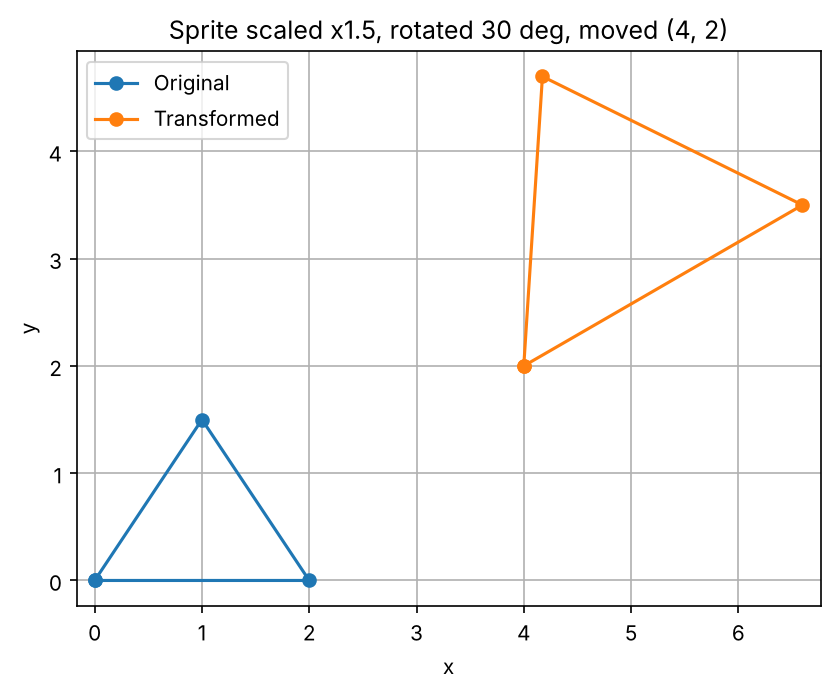
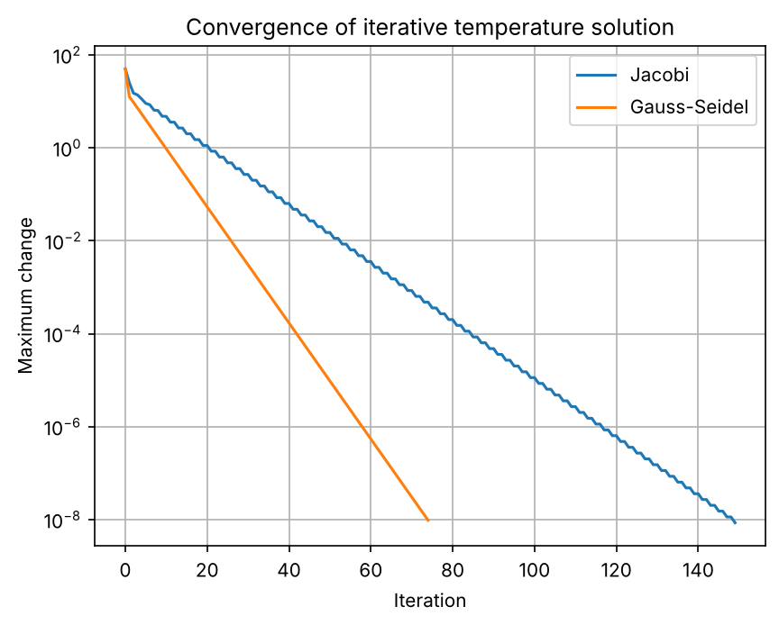
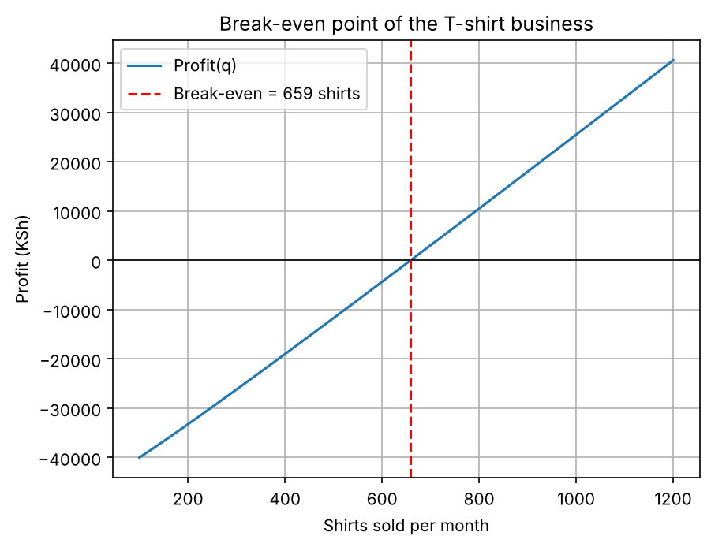
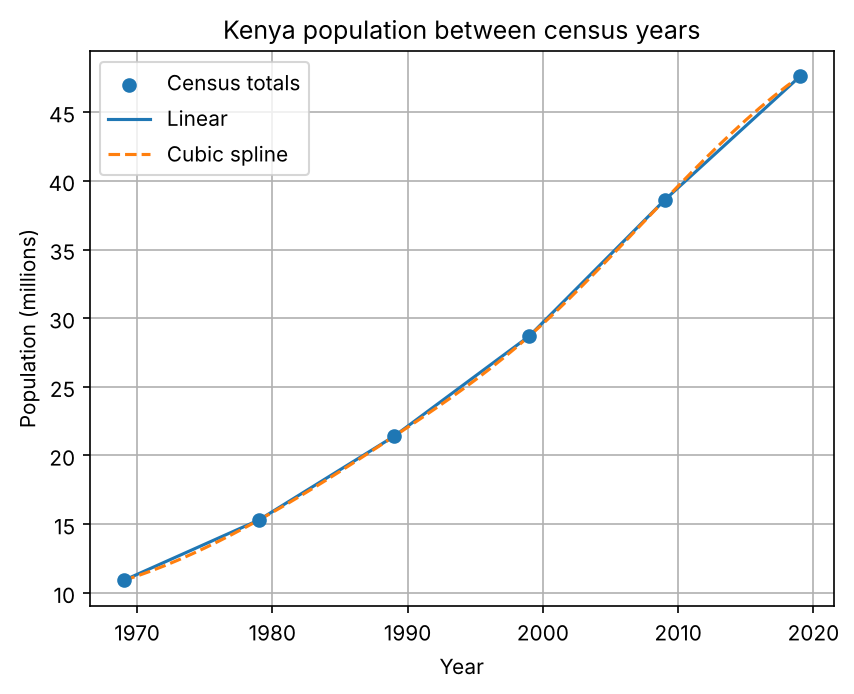
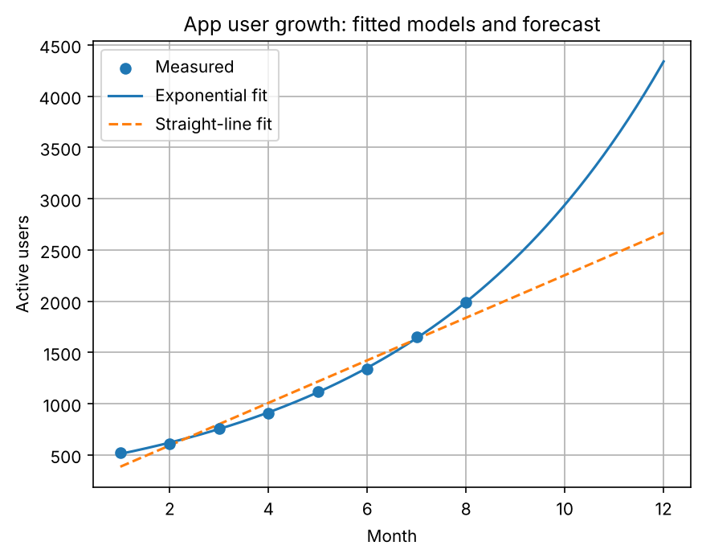
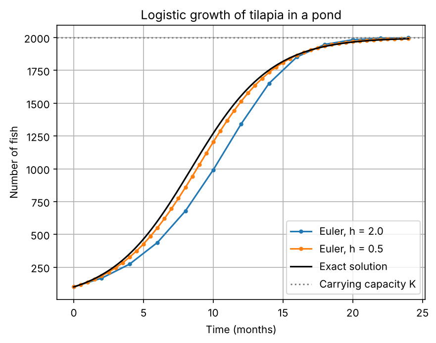
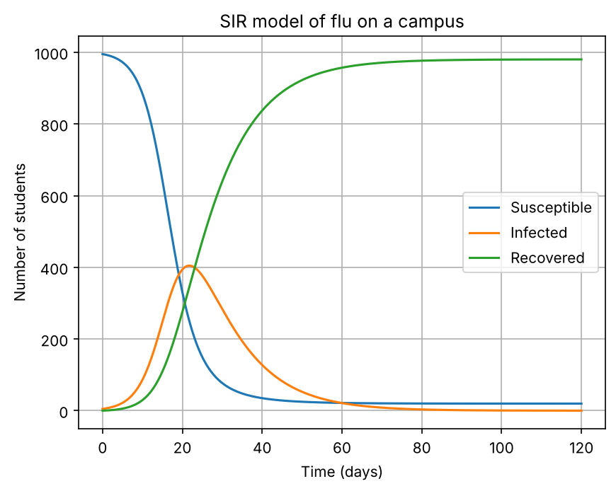
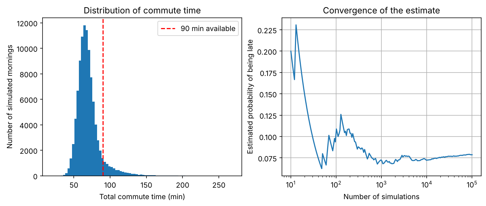

# BIT 2118 Scientific Computing - Group Work (Tasks 2 to 20)

**Group members:**

| No. | Name | Reg. No. |
|---|---|---|
| 1 | Stephen Kimani | BSCCS/2024/57444 |
| 2 | Oscar Munene | BSCCS/2025/34405 |
| 3 | Allan Mwaura | BSCCS/2024/59744 |
| 4 | Caleb Wakahua | BSCCS/2024/49983 |
| 5 | Rachael Maina | BSCCS/2025/34548 |
| 6 | Zacharia Kimani | BSCCS/2024/60395 |
| 7 | Kaburu Evans Muthomi | BSCCS/2024/62210 |
| 8 | Maureen Wairimu | BSCCS/2025/68877 |
| 9 | Maxwell Waime | BSCCS/2024/59239 |
| 10 | Carolyne Situma | BSCCS/2024/53028 |

*This documentation is submitted on behalf of the whole group. Each member has submitted their own GitHub link separately.*

## How we organised the work

For each task we ran the program from the handout, noted the inputs and the maths it does, changed one input to see what happens, explained the output, and then wrote our own program for a different real-life case. The code is in three folders:

- `code/original/` - the handout programs
- `code/changed/` - the same programs with one input changed
- `code/modified/` - our own real-world cases

Full printed outputs for every program are in the `outputs/` folder and all graphs are in `figures/`. Below we only show the main results.

---

## Task 2: NumPy Arrays

**Inputs and operation:** An array of 24 hourly temperatures in °C. The program finds the mean, minimum and maximum, then converts every value to Fahrenheit using F = 1.8C + 32 on the whole array at once (no loop).

**Output:** Mean 23.12 °C, minimum 17.5 °C, maximum 29.4 °C. So the day was coolest early in the morning and hottest around midday.

**Changing an input:** We changed one reading (12:00) from 29.4 to 35.4 °C. The maximum went straight to 35.4 but the mean only went up to 23.37, because the extra 6 degrees gets divided across 24 readings. So min and max are affected a lot by one extreme value, the mean only a little.

**Our case - electricity use at a cyber cafe:** We stored 24 hourly meter readings (kWh) and assumed a flat tariff of KSh 25 per kWh. The cafe used 53.2 kWh, costing about KSh 1,330 for the day. The peak was 5 pm (4.1 kWh) and 81.4% of the power was used during business hours (8 am to 8 pm). This tells the owner that savings should target daytime, e.g. switching off idle computers.

## Task 3: Vectorization

**Inputs and operation:** One million random latency values (in ms). Each is converted to seconds and squared, once with a normal Python loop and once with NumPy vectorized code, and `timeit` compares the speed.

**Output:** Both give the same answers but vectorized was about 45 times faster on our machine (this number changes every run). NumPy does the work in compiled C code instead of handling one number at a time.

**Changing an input:** With 100,000 values instead of a million, both times dropped to about one tenth. So time grows with the size of the data, and NumPy stays much faster.

**Our case - mobile money transaction fees:** We simulated one million transactions and charged a 0.5% fee capped at KSh 100, using `np.minimum`. Total fees came to about KSh 85.8 million and 71.5% of transactions hit the cap (anything above KSh 20,000). The vectorized version was about 34 times faster than the loop and gave exactly the same fees. So vectorization works even when the formula has a condition in it.

## Task 4: Floating-Point Errors

**Inputs and operation:** 0.1 + 0.2 compared with 0.3, √2 compared with 1.414, and two versions of the same formula for very small x. It calculates absolute and relative error.

**Output:** 0.1 + 0.2 gives 0.30000000000000004, so `==` says False but `np.isclose` says True. Using 1.414 for √2 gives an absolute error of 0.00021 (0.0151%). For tiny x the direct formula loses accuracy because it subtracts two almost equal numbers, while the rearranged formula stays correct.

**Changing an input:** Using 1.41421 instead of 1.414 reduced the absolute error to 0.0000036, about 60 times smaller. More correct digits means less error.

**Our case - billing total:** We added KSh 0.10 to a total one million times (correct answer KSh 100,000). In float32 the total was off by about KSh 958. Float64 was only off by about 0.000001 but still not exactly 100,000. `math.fsum`, `Decimal` and storing money as whole cents all gave the exact answer. Lesson: for money, use Decimal or cents, and never compare floats with `==`.

## Task 5: Matrix Algebra

**Inputs and operation:** The corners of a square, a 45° rotation and scaling of 2 (x) and 1.5 (y). The program multiplies the rotation and scaling matrices and applies the result to every point.

**Output:** The square gets stretched and turned 45°. The determinant is 3 (2 × 1.5), meaning the area becomes 3 times bigger. Rotation alone doesn't change area.

**Changing an input:** With 90° instead of 45°, the shape stands upright, e.g. (1, 0) moves to (0, 2). The determinant is still 3 because rotation only changes direction, not size.

**Our case - moving a game character (sprite):** A plain 2×2 matrix can't move a shape to a new position, so we used 3×3 matrices with points as [x, y, 1]. We scaled a triangle 1.5 times, rotated it 30° and moved it 4 right and 2 up. Its area went from 1.5 to 3.375, which matches the determinant 2.25. Multiplying by the inverse matrix brought the triangle back to where it started.

## Task 6: Linear Systems

**Inputs and operation:** Two server types use different CPU and memory. Given totals of 20 CPU and 72 GB, the program solves 4x + 2y = 20 and 8x + 12y = 72 with `np.linalg.solve`.

**Output:** 3 Type A and 4 Type B servers. Putting these back into the equations gives 20 and 72 exactly, so the residual is zero.

**Changing an input:** With totals of 24 CPU and 80 GB the answer became 4 and 4. The extra 4 CPU and 8 GB is exactly one more Type A server.

**Our case - SACCO vehicles:** We used three unknowns: 14-seater matatus, 33-seater minibuses and 51-seater buses, with seats, fuel and crew per vehicle. From the day's totals (542 seats, 950 litres, 44 crew) we got 10 matatus, 6 minibuses and 4 buses. The condition number was about 354, which means small mistakes in the recorded totals could change the answer a lot.

## Task 7: Gaussian Elimination and LU Decomposition

**Inputs and operation:** One 3×3 matrix A and three different b vectors. A is factored once into L and U, then each b is solved using those factors instead of starting from scratch.

**Output:** The first set gives x = [5, 5, 5]. Residuals are basically zero and the direct solve gives the same answer. Reusing the factors saves work without losing accuracy.

**Changing an input:** Changing the last diagonal value from 3 to 4 changed all the answers (set 1 became [4.91, 4.64, 3.66]). When A changes, the factorization has to be done again, which is why LU is only useful when A stays the same.

**Our case - currents in a 3-loop circuit:** The resistors (matrix) stay fixed while the voltages change for each test. We factored once and solved four tests. With 12 V on loop 1 the currents were 0.893, 0.279 and 0.112 A. When we doubled to 24 V, every current doubled, as expected for a linear circuit. We also wrote our own Gaussian elimination function and it gave the same currents.

## Task 8: Iterative Methods

**Inputs and operation:** A 5×5 system for temperatures between a 100 °C side and a 20 °C side. Jacobi and Gauss-Seidel start from zero and keep improving the guess until the change is below 1e-8.

**Output:** Temperatures 86.7, 73.3, 60, 46.7, 33.3 (an even drop from hot to cold). Jacobi took 150 iterations and Gauss-Seidel only 75, because Gauss-Seidel uses new values straight away. On the graph (log scale) the Gauss-Seidel line drops about twice as fast.

**Changing an input:** With the hot side at 200 °C the temperatures became 170, 140, 110, 80, 50. The number of iterations hardly changed (154 and 77) because speed depends on the matrix, not on b.

**Our case - four linked businesses:** A farm, mill, bakery and transport company each use some of the others' output. We solved (I - C)x = d to find how much each must produce. The mill has to produce about 97.5 even though customers only want 30, because the bakery needs flour. This converged much faster (22 and 15 iterations) because the matrix is strongly diagonally dominant.

## Task 9: Eigenvalues and Eigenvectors

**Inputs and operation:** An adjacency matrix for 4 connected nodes. The eigenvector of the largest eigenvalue is used to score how important each node is.

**Output:** B and C scored highest (0.28) because they have the most connections. A and D scored 0.22.

**Changing an input:** Adding a link between A and D made every node connected to every other node, so all four scored 0.25 and the eigenvalue became 3.

**Our case - PageRank for a website:** We made a 5-page site where links go one way. Using the Google matrix (damping 0.85), the Home page ranked highest (0.40) because every page links to it, followed by Portal (0.28). The Contact page got the lowest score (0.03) because no page links to it. Power iteration gave the same ranking as `np.linalg.eig` after 39 iterations.

## Task 10: Bisection and Fixed-Point

**Inputs and operation:** The function f(T) = T - 25 - 10e^(-T/20) between 20 and 40. Bisection keeps halving the interval; fixed-point keeps applying T = 25 + 10e^(-T/20).

**Output:** Both methods found the balance temperature at 27.525 °C. On the graph the curve crosses zero at that point.

**Changing an input:** Changing 25 to 30 moved the answer to 32.017 °C. It went up by about 4.5, not the full 5, because the exponential part gets smaller at higher temperatures.

**Our case - break-even for a T-shirt business:** Price KSh 120, material KSh 40 per shirt, fixed costs KSh 45,000 a month, plus an overtime cost of 300√q. Break-even is at about 658.7 shirts, so the business must sell 659 a month to make profit. At 600 shirts it loses about KSh 4,348 and at 800 it makes about KSh 10,515. Bisection took 38 steps and fixed-point took 10.

## Task 11: Newton-Raphson and Secant

**Inputs and operation:** Cash flows of -10,000 then 3,000, 3,500, 4,000 and 2,500. The program finds the interest rate where NPV = 0 (the IRR).

**Output:** IRR = 11.54%. Newton needed 4 iterations and secant needed 7, since Newton uses the exact derivative.

**Changing an input:** Reducing the investment to 9,000 raised the IRR to 16.73%. A 10% smaller cost gave about 5% more return.

**Our case - hire-purchase phone:** Cash price KSh 20,000 or 12 payments of KSh 2,100. The buyer pays KSh 5,200 extra. Solving for the rate gives 3.75% per month, which is about 45% a year (55.5% effective). We wrote Newton and secant by hand so we could see each step. Newton settled in about 3 steps.

## Task 12: Nonlinear Equations

**Inputs and operation:** A circle x² + y² = 4 and a parabola y = x² - 1, solved with `scipy.optimize.root` from two starting guesses.

**Output:** They meet at (1.517, 1.303) and (-1.517, 1.303). The starting guess decides which of the two points is found.

**Changing an input:** Making the circle radius 3 moved the meeting points to (±1.836, 2.372).

**Our case - finding a phone from cell towers:** Two towers 5 km and 4 km from a phone give two circles. They meet at (3.75, 3.31) and (3.75, -3.31), so there are two possible positions. A third tower that is 3.7 km away matches only the first point, so that's where the phone is. We also solved a polynomial for a ball thrown from a 20 m roof: it lands after 4.06 s (we ignored the negative root since time can't be negative).

## Task 13: Interpolation

**Inputs and operation:** Hourly temperatures from 8:00 to 14:00. Linear and cubic spline interpolation estimate values every 10 minutes.

**Output:** At 10:30, linear gives 23.25 °C and cubic gives 23.36 °C. Both curves pass through all the measured points but the spline is smoother.

**Changing an input:** At 12:30 the estimates were 25.25 and 25.34 °C, higher because it is close to the hottest part of the day.

**Our case - Kenya's population between censuses:** Using census totals from 1969 to 2019, we estimated the 2014 population at about 43.1 to 43.5 million. When we hid the 1999 census and tried to predict it, the spline gave 29.47 million and linear gave 30.00 (real: 28.7), so the spline did better. Estimating 2029 is outside the data (extrapolation), so it is not reliable.

## Task 14: Curve Fitting

**Inputs and operation:** Response times of a server at 50 to 350 users, fitted to y = ax² + bx + c with `curve_fit`.

**Output:** The curve fits very well (RMSE 1.55 ms) and predicts 378 ms at 400 users. The curve bends upwards, so each extra user slows the server more.

**Changing an input:** Changing the last reading from 305 to 340 ms made the fit worse (RMSE 7.79) and raised the 400-user prediction to 423 ms. One reading at the end changed the forecast a lot.

**Our case - app user growth:** Monthly active users grew from 520 to 1,990 over 8 months. An exponential model fit much better than a straight line (RMSE 8.8 vs 93.6). It shows 21.5% growth per month and users doubling every 3.6 months. For month 12 the exponential model predicts about 4,339 users and the straight line only 2,669, so choosing the right model matters a lot.

## Task 15: Numerical Differentiation

**Inputs and operation:** GPS positions every second. Speed is found using forward difference at the start, central differences in the middle and backward difference at the end.

**Output:** Speed rises from 4.8 to 8.0 m/s, roughly steady acceleration.

**Changing an input:** Changing the last position from 38 to 42 m only changed the last two speeds (to 9.65 and 12.0 m/s). Differences only use neighbouring points, so one bad reading only affects the speeds next to it.

**Our case - download speed:** A router records total MB downloaded every 2 seconds. Using `np.gradient` and converting to Mbps, the speed peaked at 34.2 Mbps at 8 seconds and the average was 22 Mbps. The forward difference results were shifted compared to central differences, because forward difference really measures the next 2 seconds.

## Task 16: Numerical Integration

**Inputs and operation:** Power readings (kW) every 2 hours. Energy is the area under the power-time graph, found with the trapezoidal rule and Simpson's rule.

**Output:** About 15.7 kWh (trapezoid) and 15.8 kWh (Simpson). They are very close, so the readings are frequent enough.

**Changing an input:** Raising the hour-6 reading from 1.8 to 3.0 kW gave 18.1 and 19.0 kWh. The gap between methods grew to 0.9 kWh, showing that a sharp peak needs more frequent readings.

**Our case - distance covered by a matatu:** We used speedometer readings every 10 seconds for 2 minutes. Distance came to about 1,340 m (average 40 km/h). Using only readings every 20 seconds, the two methods disagreed by about 30 m, so fewer readings means less certainty.

## Task 17: Euler Method

**Inputs and operation:** Newton's law of cooling, starting at 90 °C in a 25 °C room with k = 0.12 and a step of 1 minute.

**Output:** After 30 minutes Euler gives 26.40 °C and the exact answer is 26.78 °C (error 0.37). The temperature drops fast at first then levels off near room temperature.

**Changing an input:** With a step of 5 minutes the largest error went up from 1.5 to 9.7 °C. Bigger steps are faster but less accurate.

**Our case - tilapia in a fish pond:** We used logistic growth with 100 fish at the start and a pond limit of 2,000. The population follows an S-shaped curve and grows fastest around month 8.4 (at 1,000 fish). With a 2-month step Euler was off by up to 279 fish; with a half-month step it was off by 72.

## Task 18: ODEs with SciPy

**Inputs and operation:** An RC circuit with 5 V supply, R = 1000 Ω and C = 0.001 F, solved with `solve_ivp`.

**Output:** After 5 seconds the capacitor is at 4.966 V, almost full. The error compared to the exact formula is tiny (about 1e-9 V), much better than Euler.

**Changing an input:** Doubling R to 2000 Ω made charging slower, only 4.59 V after 5 seconds.

**Our case - flu on campus (SIR model):** 1,000 students, 5 sick at the start, infection rate 0.4 and recovery rate 0.1 per day. The number sick at once peaks at about 405 students around day 22. By the end about 980 students had been infected. The peak is the useful number for planning, e.g. how many students might miss class at the same time.

## Task 19: Optimization

**Inputs and operation:** Server A costs 12 for 100 capacity, server B costs 18 for 170. We need at least 1,000 capacity at minimum cost, solved with `minimize` (SLSQP).

**Output:** The cheapest plan uses only Type B (5.88 units, cost 105.88), because B gives more capacity per shilling. With whole servers it's 6 Type B for a cost of 108.

**Changing an input:** Needing 1,500 capacity gave 8.82 units (cost 158.82), or 9 whole servers for 162. Still all Type B.

**Our case - cheapest chicken feed:** Mixing maize (KSh 45/kg) and soya (KSh 95/kg) to make 100 kg with at least 18% protein and enough energy. The best mix is about 74.3 kg maize and 25.7 kg soya, costing KSh 5,786. Protein ends up exactly at 18%, so protein is what limits the cost. A 50/50 mix would cost KSh 1,214 more. We checked the answer with `linprog` and got the same.

## Task 20: Monte Carlo

**Inputs and operation:** Server demand is random (mean 850, standard deviation 120) and capacity is 1,000. We simulate 100,000 cases and count how many overload.

**Output:** About 10.6% overload. The graph shows the estimate jumping around at first, then settling as the number of simulations grows.

**Changing an input:** With capacity 1,100 the overload chance dropped to 1.9%. Only 10% more capacity reduced the risk more than five times.

**Our case - getting late for an 8 am class:** We simulated a Thika to Nairobi trip: waiting for the matatu, the drive, a 25% chance of a traffic jam, and the walk to class, with 90 minutes available. These times are our own estimates. The average trip is about 70 minutes, but a student would still be late about 7.9% of the time. Almost all of that comes from jam days (31% late, compared to 0.2% on normal days). To be on time 95% of the time, you'd need to leave about 99 minutes before class.

